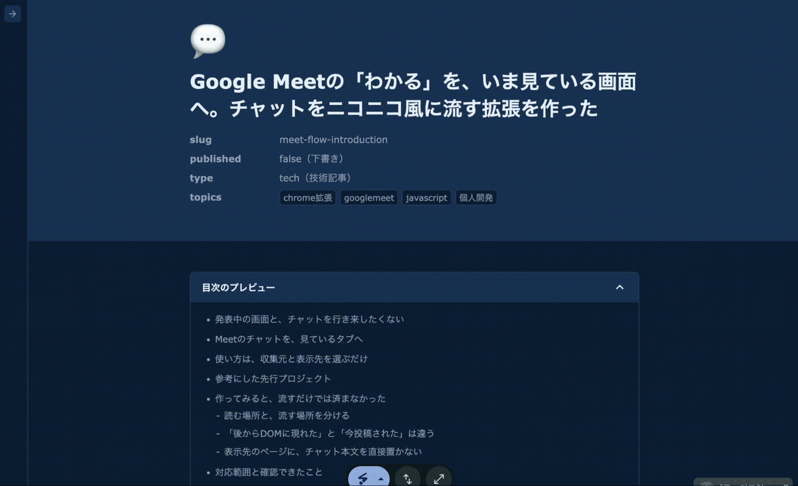
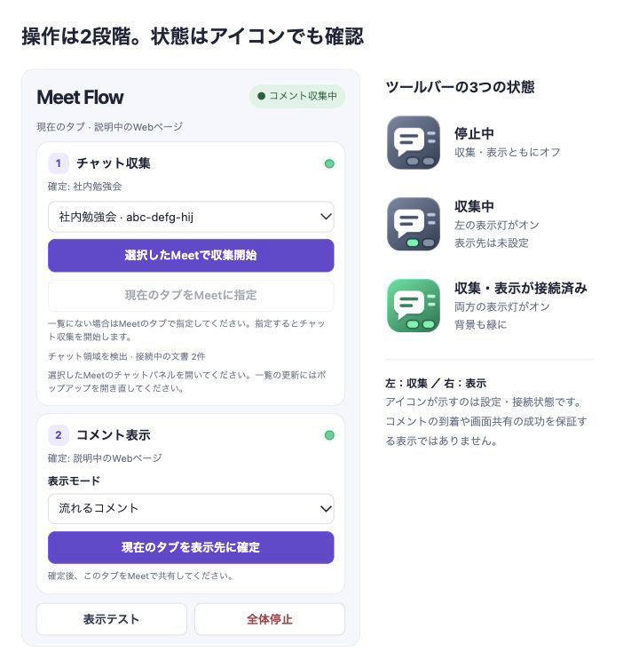
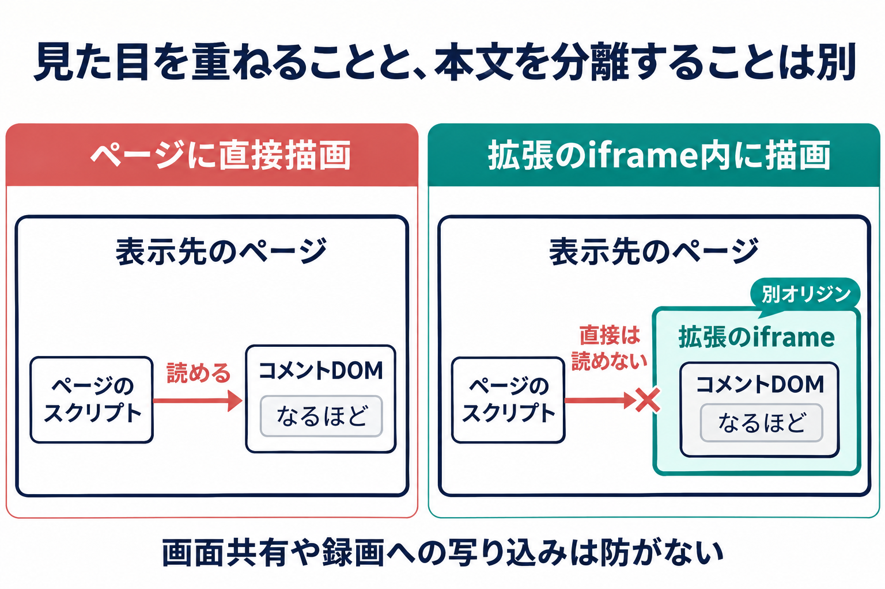

## 社内発表で、参加者の反応を拾いたかった

社内発表会で、画面を操作しながら説明していると、オンライン参加者の反応まで追うのは難しいなと感じました。Meetのチャットに「なるほど」「わかる」と書かれていても、読みに行くには説明中のWebページから目を離す必要があります。

マイクをオンにして話すのは、聞く側もちょっと勇気がいる。チャットやSlackのスレッドなら短い感想を書きやすいのに、発表者がその反応を拾うには、説明とチャットの間を行ったり来たりする必要があります。

## 昔のニコニコ動画を思い出した

そこで思い出したのが、昔のニコニコ動画でした。動画の上にコメントが流れてくる、あの見せ方です。

**発表中に見ている画面にも、反応のほうが流れてきたらどうだろう。** チャットを見に行かなくても、「なるほど」「わかる」に気づけるかもしれない。まずは、その仕組みを作ってみることにしました。

## 同じことを考えた人は、すでにいた

調べてみると、Meetのチャットを画面に流す先行プロジェクトがありました。[kazizi55さんのGoogle Meet Comment Flow](https://github.com/kazizi55/google-meet-comment-flow)と、そのフォークである[yui666aさんの版](https://github.com/yui666a/google-meet-comment-flow)、[m-narinさんの版](https://github.com/m-narin/google-meet-comment-flow)です。

これらは、MeetのチャットDOMを調査する際の参考にしました。特にyui666aさんの版は、本文や発言者名を探すためにDOMの構造を確認する手掛かりになっています。

今回は、自分の発表で欲しい動作を整理し、拡張自体はスクラッチから実装しました。先行プロジェクトの調査を足掛かりに、どのMeetから受け取り、どのWebタブに表示するかを自分で組み立てていきました。

## 自分の発表で使うために作ってみた

作ったのは、Google Meetの新しいチャットを、選んだWebタブの上に右から左へ流すChrome拡張「Meet Flow」です。たとえば誰かが「それ便利そう」と書くと、説明中のWebページにもその言葉が流れます。

*実際の表示例。見ているWebタブの上にコメントが流れます。*

表示先はWebページやWebアプリでも、収集元と同じMeetタブでも構いません。構成は通常のJavaScriptとChrome Manifest V3で、拡張の実行・ビルドに外部パッケージは使わず、チャットを中継する自前のサーバーも置いていません。

https://gist.github.com/sunyeul/1b6f844732b366317f05c5f01ecdbb39

## 流すだけでは済まなかった

文字を横に動かすだけなら小さな機能ですが、発表中に使うには、意図した場所にだけ表示し、操作の邪魔をしないことも必要でした。ここでは、作りながら考えた三つの点を紹介します。

### どこから集めて、どこに表示するか

発表中に見ているのは、Meetの画面とは限りません。そのため、チャットを収集するMeetと、コメントを表示するWebタブは別々に指定できるようにしました。タブを切り替えただけでは表示先を変えず、表示先のページが再読み込み・移動されたら表示先を解除します。

この分離に合わせて、ポップアップも「①チャット収集」「②コメント表示」の二段階にしました。Meetで収集を始め、表示したいWebタブで拡張を開いて表示先を確定する流れです。表示先には、そのタブで得る[`activeTab`](https://developer.chrome.com/docs/extensions/develop/concepts/activeTab)の一時アクセスを使い、全サイトへの常時アクセスを求めない構成にしています。

*実装のHTML・日本語UI・アイコンを使った表示例。会議名と接続状態はサンプルです。*

ツールバーアイコンの左の表示灯は収集、右は表示の状態で、両方がオンになると背景も緑に変わります。操作の結果や接続エラーはポップアップ内に出し、発表中のWebページには重ねません。コメントの表示面もクリックを通し、元のページをそのまま操作できるようにしました。

大きく動くコメントを避けたい場合には、右下にチャットを積むモードも選べます。表示方式を切り替えると、以前のコメントは消して新しい方式に切り替えます。

なお、拡張の表示先指定とMeetの画面共有は別の設定です。参加者にも見せる場合は、Meetで共有を別途開始します。「表示テスト」も表示先への接続を確かめるもので、チャット収集や共有先での表示まで確認する機能ではありません。

### 新しい投稿だけを、一度ずつ流したい

途中から収集を始めたとき、過去のチャットまでまとめて流れるのは避けたいところです。そこで、開始時にすでに存在する確定済みの投稿は除外し、その後に現れる投稿を対象にしました。

もう一つ気をつけたのが、送信途中の投稿です。Meetでは、送信待ちの表示が確定後に別のDOMへ置き換わることがあります。両方を新規投稿として拾うと、同じコメントが二度流れてしまいます。

そのため、送信待ちの間は流さず、確定してからメッセージIDを使って重複を除外します。同じ「わかる」でも、別々のIDを持つ投稿ならそれぞれ届けます。

| 投稿の状態 | 扱い |
| --- | --- |
| 開始時にすでに存在する確定投稿 | 表示しない |
| 送信待ちの投稿 | 確定するまで待つ |
| 処理済みのIDを持つ投稿 | 再表示しない |
| 未処理のIDを持つ確定投稿 | 表示する |

ただし、開始後に読み込まれた過去記録と新規投稿を完全には区別できません。IDが取れない投稿も表示対象にしないため、すべてのチャットを漏れなく流す仕組みではありません。

### チャットを重ねても、表示先サイトには本文を渡したくない

たとえば、外部のWebサービスを画面に出しながら、社内のチャットを重ねるとします。見ている人には読んでもらいたいですが、そのWebサービスに社内の会話まで読めるようにはしたくありません。

コメントを[Webページの一部として追加すると、そのページのプログラムからも読み取れます](https://developer.chrome.com/docs/extensions/develop/concepts/content-scripts)。画面に重ねるつもりが、ページの中に会話を書き込むことになるわけです。

そこで、拡張機能が持つ**iframeという別枠の中**にコメントを表示しました。見た目はページの上に重なりますが、中身はページと分かれていて、[ページ側のプログラムからは直接読めません](https://developer.mozilla.org/en-US/docs/Web/Security/Defenses/Same-origin_policy)。

*表示先ページから本文DOMを分離する考え方（AI生成の概念図）。*

本文と発言者名は拡張のストレージへ保存せず、外部サーバーへ送信する処理も入れていません。ただし、診断用のコンソールログには本文の一部やDOM情報が含まれます。画面共有や録画への写り込み、表示先ページがiframeを隠したり削除したりすることまで防ぐ仕組みではありません。

## 社内発表で使ってみた

Meet Flowを実際の社内発表で使いました。参加者からは、こんな感想をもらいました。

> 感想・お気持ちのチャットが打ちやすかったです

もともとは、発表者が参加者の反応に気づけるようにするために作ったものです。返ってきたのは、参加者側の「感想を書きやすかった」という声でした。発表者への見せ方に加えて、書き込む側の体験についても考える材料になりました。

## 作って分かったことと、PRD

反応をいま見ている画面に届けるには、文字の動きだけでなく、収集と表示の指定、過去記録の扱い、本文の置き場所も決める必要がありました。社内発表で使ってみると、参加者側の書きやすさについても感想をもらえました。

Meet Flowは非公開DOMに依存するため、Meet側のUI変更で収集が動かなくなる可能性があります。表示先はブラウザ内のWebタブが対象です。今回の使用とは別に、右下チャットの発言者名の対応や、画面共有を受ける参加者側の表示には追加確認が必要です。

ここまでの要件と受け入れ条件は、PRD（プロダクト要求仕様書）にまとめました。コードやインストール用ZIPは配布せず、PRDのみをGistで公開しています。同じような仕組みを考える際や、ClaudeやCodexに実装を依頼する際の出発点になればと思っています。

https://gist.github.com/sunyeul/1b6f844732b366317f05c5f01ecdbb39
