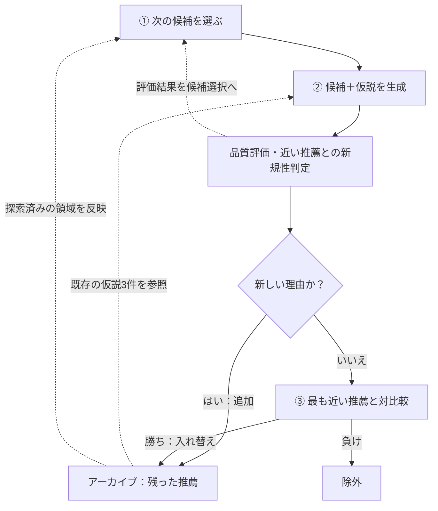

## はじめに

LLMに「おすすめの株」を聞くと、もっともらしい理由が返ってきます。ただ、その理由だけでは、ほかにどんな候補を検討したのか、似た話ばかり集まっていないかは分かりません。

Sakana AIの[QD-Rec](https://pub.sakana.ai/qd-rec/)は、候補と推薦理由をセットにして、質と多様性の両方を考えながら蓄積する手法です。これを米国株に当てはめて、「銘柄＋投資論理」のアーカイブを作ってみました。

**今回見えたのは、広い銘柄探索と、別の銘柄へ投資論理を転用する動きでした。** 残ったアイデアの収益源も、比較手法より均等に近い分布になっています。ただし、リターンの優位性や審査点の予測力は確認できませんでした。

対象は2026年4月30日時点のS&P 500構成銘柄503件。共通の初期アイデア10件から各手法で300回評価し、選んだ20銘柄のその後を調べた、小さな実験です。投資判断に使える精度を示すものではありません。

## QD-Recの特徴は、推薦理由も探索すること

### 候補は有限でも、推薦理由は尽きない

たとえば、同じ会社を「利益成長が期待できるから」「配当が安定しているから」「割安さが解消しそうだから」と推薦できます。候補の銘柄数が決まっていても、その見方まで1つに決まるわけではありません。

[QD-Recの論文](https://arxiv.org/abs/2610.23470)では、**候補と、その候補が利用者の目的に合うという仮説の組**を探索します。株式なら「銘柄＋投資論理」です。

QDはQuality–Diversityの略です。高い評価を得る推薦を集めながら、異なる見方も残す。そのために、候補選択、仮説生成、アーカイブ更新を繰り返します。

### 特徴① 次に調べる候補を選ぶ

すべての銘柄について何通りもの論理を生成し、審査するには費用がかかります。限られた回数をどこに使うか。その役割を担うのが、**多様性を考慮するコンテキスト付きバンディット**です。

銘柄情報をまとめたカードの埋め込み（内容を表す数値ベクトル）と過去の評価から、有望そうな候補を探りつつ、まだ評価が不確かな候補も調べます。さらに、既存アーカイブと似ていない候補に探索のボーナスを付け、手薄な領域へ向かいやすくします。

これにより、良さそうな候補を掘り下げることと、まだ手薄な領域を調べることを両立させます。

### 特徴② 過去の仮説を、次の仮説の足場にする

生成モデルには、選んだ候補と利用者の目的に加えて、アーカイブから無作為に選んだ3件の推薦を渡します。その見方を別の候補へ転用したり、組み合わせたり、例にない方向を試したりします。

論文では、それぞれを**変異（mutate）・交叉（crossover）・探索（explore）** と呼んでいます。残した推薦が次の生成例にもなるので、アーカイブは結果の保存場所と、次の発想の材料を兼ねます。

モデルの重みは固定したまま、参照できる推薦の集合を育てていく仕組みです。

### 特徴③ 新しい理由は残し、似た理由同士で競わせる

高得点の推薦だけを全体で選ぶと、同じ種類の理由に偏るかもしれません。QD-Recは、新しい推薦を埋め込みで近い既存3件と照合し、残し方を分けます。

| 判定 | アーカイブでの扱い |
| --- | --- |
| 既存にない推薦理由と判断された | 点数で既存全件を上回らなくても追加 |
| 既存の推薦に似ている | 最も近い推薦と対比較し、勝てば入れ替え、負ければ除外 |

対比較では、点数と新旧の区別を隠し、提示順も入れ替えます。この**局所的な競争**によって、似た見方の中では良いほうを残し、異なる見方は共存させます。

*QD-Recの概念図。今回は生成と品質評価の間に数値検査・反論生成も挟みます。*

このループが株式でも動くのか、まずは1銘柄の入力と出力から見ていきます。

## 実験：銘柄と投資論理をセットで残す

### Travelersの投資アイデアを1枚で見る

候補となる503銘柄には、価格・財務指標、事業概要、直近30日間のニュース要約をまとめた「銘柄カード」を用意しました。ニュースは事実と解釈が分かれる点を分けています。

Travelers（TRV）は、[住宅・自動車・企業向けの損害保険を手がける会社](https://www.travelers.com/about-travelers)です。そのカードと既存アイデアから、どんな推薦が生まれるのか。最終ポートフォリオで最高点タイだった出力を、1枚にまとめました。

*モデルが生成した投資論理と反論の要約。2026年4月30日の実験記録より。イラストは保険事業のイメージです。*

:::details カードの内容をテキストで読む

> **Travelers：収益性と割安さに注目するアイデア**
>
> - **投資論理：** 引受業績と災害損失の減少が好業績を支える。PER 10.20倍、利益成長率25.80%、ROE 19.00%から、収益性に対して割安と見る。
> - **上昇のきっかけ：** カリフォルニア州での住宅保険拡大、次の決算。
> - **リスク：** 好業績がすでに株価に織り込まれている可能性や、売上の予想未達。
> - **見直す条件：** 純利益率が8%を下回る、または四半期利益が前年同期比で減少する。
> - **反論：** 低い過去PERだけでは将来の割安さは分からない。足元の好業績と株価上昇を踏まえると、期待が先行しているかもしれない。
>
> **審査点は5.10点。** 審査者が出した「3か月でS&P 500を上回る確率」0.51を10倍した値です。

:::

入力のPERやROEに、「収益性に対して割安」という見方が加わったところが、候補と仮説の組です。数字は実験の入力カード由来で、企業の原資料まで独立に照合した値ではありません。反論と見直す条件も残るので、あとから検討の前提をたどれます。今回は、その条件が実際に成立したかまでは追跡していません。

ほかの銘柄でも、成長や配当など、注目する収益源が異なりました。

| 銘柄 | 注目した収益源 | 投資論理の要約 | 反論の要約 |
| --- | --- | --- | --- |
| NetApp（NTAP） | 成長 | クラウド連携とAI運用需要、利益成長に注目 | 売上より利益の伸びが大きく、コスト削減への依存や高い負債を懸念 |
| Kimco Realty（KIM） | 防御・配当 | 食料品店を核とする商業施設の賃料収入と配当 | 成長を織り込んだ株価や負債が配当余力を圧迫する可能性 |
| Textron（TXT） | モメンタム | 株価の上昇傾向と軍用車両・航空機の受注 | 利益率が低く、受注増が利益に結びつくとは限らない |
| Netflix（NFLX） | クオリティ | 利益成長、ROE、自社株買い | 過去12か月の株価推移が弱い |

### 株式向けに追加した処理

QD-Recの探索ループに、今回は**数値検査**と**反論生成**を加えています。生成された論理には、別のモデルが反論を付けます。その後、審査者への問い合わせ前に数字をカードや投資家プロファイルと照合し、規則に合わなければ0点として除外。通過した論理は、審査者が反論と合わせて評価します。

### 点数は何を表すのか

審査者には、3か月でS&P 500を上回る確率を尋ね、その10倍を点数にします。ただし、根拠が不十分と判定された場合も0点になります。実現リターンと照合して、点数が銘柄選びに役立ったかも調べます。ただし、確率の校正はできていないため、0.51という出力が実際に51%の頻度で当たるとは限りません。

:::details 使用モデル

- 投資論理の生成：`google/gemini-3.5-flash-lite`（推論強度low）
- 反論・ニュース要約：`google/gemini-2.5-flash-lite`
- 審査・新規性判定・対比較：`typesafe/jev-1.14`
- 埋め込み：`openai/text-embedding-3-small`（512次元）

:::

## 比較条件と、過去の再現に残る限界

### 同じ300回で何を比べたか

比較には、既存実装のアブレーションである**Novelty**を使いました。新規性判定と対比較は共通で、次の2点が異なります。

| 条件 | QD-Rec | Novelty |
| --- | --- | --- |
| 次の銘柄の選び方 | バンディット | 無作為 |
| 生成時に参照する既存アイデア | 3件 | なし |
| 共通の初期アイデア | 10件 | 10件 |
| 主ループの評価回数 | **300回** | **300回** |

**Noveltyにも、新規性判定と局所的な競争はあります。** 今回見るのは、候補選択と既存アイデアの参照を加えた構成の違いです。2要素を同時に変えているので、それぞれの効果は分離できません。論文には既存例の参照だけを加える`Novelty+Evo`もありますが、今回は実行していません。

投資家の目的は「3〜12か月保有し、コスト控除後でS&P 500を上回ること」。米国大型株の買いのみで、レバレッジやオプションは使わない設定です。

終了後は、残ったアイデアから銘柄ごとの最高点を取り、セクターごとに最大3銘柄という制限で上位20銘柄を選び、均等配分しました。実現リターンは選定に使わず、その後の評価に使います。

### 「当時の情報だけ」を完全には再現できていない

LLMを使う過去検証では、入力データの時点だけでなく、モデルがその後の出来事を知っている可能性も問題になります。

**厳密な過去情報だけの再現にはなっていません。** 財務の利用可能時点は年度末から60日遅れで近似し、事業概要と株式数には取得時点の値を使っています。モデルの知識からの漏れも排除できていません。この制限を含む1時点のバックテストとして読みます。

:::details モデルの知識と入力データの時点に関する制限

生成モデルの学習期限を考慮してスナップショット日を選んでいますが、公開ファイルからは審査者Jevの学習期限を確認できません。設定ファイルには株価変動に関する事前確認の記録があるものの、その原結果は公開ファイルから照合できないため、ここでは未来の知識がない根拠には使いません。

入力データにも、次の制限があります。

- **構成銘柄・価格：** Wikipediaの過去版で構成銘柄を復元し、カードの価格指標には基準日までのデータを使う。ただし、過去のティッカーでデータを取得できないものは欠ける。
- **財務：** 年次財務から指標を再計算し、会計年度末から60日後に利用可能になると仮定する。実際の提出日や、その時点の修正前の値を厳密に復元したものではない。
- **ニュース：** 前日までの記事タイトルを対象にするが、取得時点のGoogle News検索で見つかった記事に依存する。
- **事業概要・株式数：** 取得時点の概要と株式数を使う。過去の時価総額やPERなどにも、後日の増資・自社株買いの影響が混ざりうる。

:::

## 実験で、3つの特徴はどう見えたか

Travelersのようなアイデアを集める過程で、3つの仕組みがどう働いたかを見ていきます。いずれも同じスナップショットで、各手法を1回ずつ実行した記録です。

### ① 候補選択：300回すべて異なる銘柄を調べた

*上：主ループで評価した銘柄数と、初期シードを含む最終アイデア数。下：収益源の構成比。両手法とも300回評価。*

Noveltyが223銘柄を調べたのに対し、QD-Recは300回すべて異なる銘柄を選びました。今回の候補選択は、同じ銘柄を掘り下げるより、探索を広げる方向に働いています。アーカイブに残った件数も **206対165** でした。

ただし、これは未訪問銘柄を必ず選ぶ規則ではありません。今回の予算と候補集合で見えた振る舞いです。

### ② 仮説の転用：Gen Digitalの見方がTravelersへつながった

先ほどのTravelersには、発想の元になったアイデアも記録されています。Gen Digitalを推薦する際に使った、収益性に注目する見方です。

- 参照元のGen Digital：高い利益率と業績見通しに注目する。
- 新しいTravelers：収益性とバリュエーションという観点を、低PERと利益成長に当てはめる。

生成モデルは、既存例の収益性と割安さの観点を使ったと記録しています。単に同じ銘柄の説明を言い換えるのではなく、別の銘柄へ見方を持ち運ぶ例になっていました。これはモデルの自己申告を含む記録であり、参照なしとの比較で改善効果を確認したものではありません。生成操作の記録は300件すべて`mutate`で、交叉や`explore`の挙動までは今回観察できていません。

### ③ アーカイブ更新：異なる理由が残り、似た理由は入れ替わった

上の構成比グラフは、残ったアイデアをJevで7つの収益源に事後分類したものです。探索中はこの分類の箱に振り分けるのではなく、推薦同士の近さから新規性を判断しています。

成長に分類された割合は、QD-Recが30.58%、Noveltyが41.82%。分布の均等さを表す正規化エントロピーも0.93対0.87でした。1に近いほど各分類が均等になる指標で、この分類ではQD-Recの偏りが小さくなっています。

一方、埋め込みの平均ペア間コサイン距離は0.42対0.43で、QD-Recのほうがわずかに低い値でした。**違いが見えたのは探索銘柄数と収益源の分布で、多様性の全指標が上がったわけではありません。** 収益源の分類自体もモデルに依存し、投資リスクの分散を保証するものではありません。

局所的な競争は、次の入れ替えにも表れています。

> **Extra Space Storage → Kimco Realty**
>
> 配当と利益成長に注目した既存のREITアイデアに対し、似た理由を持つKimco Realtyのアイデアが提案されました。ブラインドの対比較で新しいほうが選ばれ、既存アイデアを置き換えています。

似たアイデアを整理しつつ、異なる理由を残す更新が動いていました。このルールはNoveltyにも共通なので、件数や構成比の差を、新規性判定だけの効果とは解釈できません。

#### 点数の高いアイデアは蓄積したか

*各時点の上位20件を集計（20件未満の時点は全件）。平均審査点の上昇は、実現リターンの改善とは別。*

上位20件の平均審査点は、QD-Recが3.68から4.79、Noveltyも3.08から4.67へ上がりました。高得点のアイデアが蓄積する動きは両手法にあり、QD-Recだけに見られた変化ではありません。

ここで残ったのは1銘柄につき1アイデアでした。同じ銘柄に異なる仮説を重ねる余地はありますが、その特徴を観察するには、再訪が起きるだけの評価回数が必要そうです。

## 探索で見えた特徴は、リターンにもつながったか

審査者が良いと判断する論理は集まりました。では、それを使って選んだ20銘柄は、実際にも良い結果になったのでしょうか。

基準日の終値から、21営業日後を1か月、63営業日後を3か月として、調整後終値で測りました。これは基準日終値で組成できたと仮定する計算で、カードを読んでから実際に約定できる価格を検証したものではありません。表はSPYに対する超過リターンで、単位はパーセントポイント（%p）です。

| 手法 | 1か月 | 3か月 |
| --- | ---: | ---: |
| **QD-Rec** | **−5.85%p** | **+0.52%p** |
| **Novelty** | **−5.69%p** | **+0.49%p** |
| 対象503銘柄の均等配分 | −3.31%p | +1.00%p |
| RSP（S&P 500均等配分ETF） | −2.71%p | +1.88%p |
| QQQ（NASDAQ 100 ETF） | +5.68%p | −1.07%p |

QD-Rec、Novelty、503銘柄の均等配分には往復0.20%の取引コストを差し引き、ETFには追加の売買コストを差し引いていません。

1か月では両手法ともSPYを下回り、3か月ではSPYを少し上回りました。**QD-RecとNoveltyの差は、1か月で−0.16%p、3か月で+0.03%p。今回の結果から、リターン上の優位性は示せません。**

QQQが強く、均等配分が弱い1か月でした。銘柄の選び方だけでなく配分制約も結果に影響しうるため、セクター上限の寄与は、上限なしの比較で別に確かめる必要があります。

個別では、TRVは1か月でSPY比−10.86%p、3か月で+18.98%pでした。Netflixは3か月で−27.61%p。同じ手順で選んでも、その後は大きく分かれています。

### 高い点数ほど、よく上がったのか

審査点と超過リターンの順位相関（IC）も調べました。対象は20銘柄だけでなく、最終アーカイブに残った各銘柄の最高点です。

| 手法 | 対象銘柄数 | 1か月IC | 3か月IC |
| --- | ---: | ---: | ---: |
| **QD-Rec** | 206 | **+0.01** | **+0.03** |
| Novelty | 165 | **−0.05** | **+0.07** |

正の値が大きいほど、点数の高い銘柄の実現リターンも高い関係を表します。今回の値は小さく、3か月を評価する審査点と3か月リターンの間にも、強い関係は見えませんでした。

:::details ICの標準誤差の扱い

レポートには約0.07〜0.08の標準誤差もありますが、これは銘柄数から`1 / √(n − 1)`で求めた簡易値です。同じ市場の銘柄間の依存を扱った検定ではないため、有意差を厳密に判定する根拠には使いません。

:::

ポートフォリオの点数も4.40〜5.10に集まっていました。この狭い点数差が、銘柄を選び分ける有用な信号になっているかが、次の課題です。

## 個人で試せるコストだったか

記録されたAPI費用と時間は、次のとおりです。

| 手法 | 記録された費用 | 記録された時間 |
| --- | ---: | ---: |
| QD-Rec | **$0.74** | 4.20分 |
| Novelty | **$0.44** | 5.80分 |

ここには集計上の注意があります。**先に実行したQD-Rec側には、銘柄カード・埋め込み・初期アーカイブの生成が含まれます。後続のNoveltyは、共通の生成物を再利用します。** 事前のデータ取得や、その後のレポート生成はこの区間の外です。

API費用は累積利用額の差分で測っており、計上遅延で隣の実行へ少しずれる可能性もあります。小額で試せた実例ではありますが、この表から両手法の費用・時間の効率差を比較することはできません。

### 数字の検査で止められること、止められないこと

QD-Recの300回中16回、約5.33%は数値検査で除外されました。これは「規則で不一致を検出した割合」であって、生成された誤情報の総量ではありません。

見直す条件の閾値や保有期間は、新しく設定する値なので検査対象外です。また、検査器が対象にするのは主にアラビア数字です。実際にEOGの論理には、`thirty-one point six percent`のように英単語で書かれた数字がありました。入力カード由来とされた値ですが、この表記で誤った値を書いても検査をすり抜ける余地があります。

また、数字が一致していても、その解釈まで正しいとは限りません。Travelersの「このPERなら割安」という判断も、カードと同じ数字を使っていることとは別に検討する必要があります。

## 今回見えたことと、次に確かめたいこと

最初に気になっていた「何を、どんな理由で検討したのか」は、アーカイブと生成記録からたどれました。とくにTravelersでは、入力カードの数字に、Gen Digitalから持ち込んだ見方が重なり、1つの投資論理になる過程が見えます。

探索は広がり、似た論理の入れ替えも起きました。ただ、審査点の高いアイデアを残す仕組みが動いても、リターンの予測力までは確認できませんでした。QD-Recを株式に使うなら、探索の仕組みと審査者の有用性を、それぞれ確かめる必要があります。

次は、日付と乱数シードを増やして、探索範囲と収益源の差が繰り返されるかを調べたいと思います。さらに評価回数を増やせば、今回ほぼ見られなかった「同じ銘柄に複数の見方を蓄積する」動きも観察できるかもしれません。財務データの時点の厳密化や審査点の検証も、その前提として進めたいところです。

## 参考

- [QD-Rec論文：Open-Ended Evolution of Recommendations via Quality-Diversity](https://arxiv.org/abs/2610.23470)
- [Sakana AIのプロジェクトページ](https://pub.sakana.ai/qd-rec/)
- [今回の実装リポジトリ](https://github.com/sunyeul/qd-rec-stocks)

数値は[結果レポート](https://github.com/sunyeul/qd-rec-stocks/blob/ac82b1f6dc133f588f7444ed6be4de7758c24760/reports/backtest500.md)、集計条件は[指標の計算](https://github.com/sunyeul/qd-rec-stocks/blob/ac82b1f6dc133f588f7444ed6be4de7758c24760/evaluation/report.py)、[リターンの計算](https://github.com/sunyeul/qd-rec-stocks/blob/ac82b1f6dc133f588f7444ed6be4de7758c24760/evaluation/returns.py)、[実行と費用の集計](https://github.com/sunyeul/qd-rec-stocks/blob/ac82b1f6dc133f588f7444ed6be4de7758c24760/scripts/backtest.py)で確認できます。各リンクは、この記事で参照したコミットに固定しています。公開されているのはコードと集計済みレポートで、入力データや全生成ログは含まれていません。
